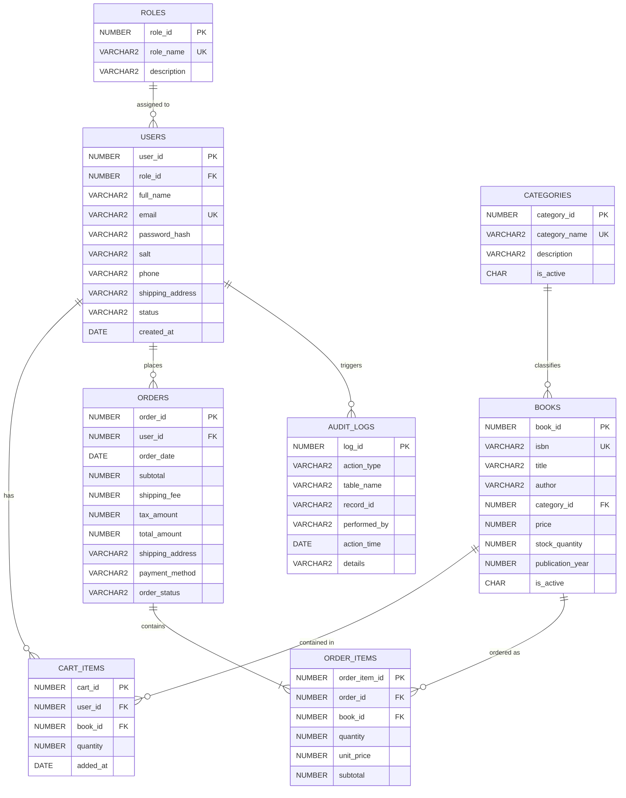

# 📚 Online Bookstore Management System (PL/SQL)

An enterprise-grade **Online Bookstore Management System** built with **Oracle PL/SQL**, stored packages, triggers, cursors, secure cryptographic hashing, and a modern interactive web interface.

---

## 🌟 Key Features

### 1. User Management (`USER_MGMT_PKG`)
* **Registration:** Validates inputs, prevents duplicate email accounts, generates cryptographically random salts, and securely hashes passwords.
* **Authentication:** Secure login validation comparing salt-hashed passwords.
* **Profile Management:** View and update user details (contact information, shipping addresses).
* **Role-Based Access Control (RBAC):** Distinct roles for `CUSTOMER` and `ADMIN`.

### 2. Book Management (`BOOK_MGMT_PKG`)
* **Catalog Management:** Administrators can add new books, update titles, authors, prices, inventory levels, and publication metadata.
* **Soft & Hard Deletion:** Safe deactivation mechanism preserving historical order integrity.
* **Multi-Criteria Search:** Search books by title, author, category, ISBN, price range, and stock availability using PL/SQL `SYS_REFCURSOR`.

### 3. Shopping Cart (`CART_MGMT_PKG`)
* **Real-time Cart Management:** Add items, dynamically adjust quantities, or remove titles.
* **Stock Checks:** Real-time stock availability validation prior to cart additions.
* **Order Totals Calculation:** Automatic computation of line totals, sales taxes (8%), and tiered shipping fees (Free shipping over $35).

### 4. Order Processing & ACID Transactions (`ORDER_MGMT_PKG`)
* **Atomic Checkout:** Wrapped in database transactions with `SAVEPOINT` rollbacks, concurrency locks (`FOR UPDATE`), inventory deductions, and cart clearing.
* **Order Status Workflow:** Lifecycle progression through `PENDING` ➔ `PROCESSING` ➔ `SHIPPED` ➔ `DELIVERED`.
* **Automatic Inventory Restock:** Trigger automatically replenishes book stock when an order is cancelled.

### 5. Analytical Reporting (`REPORT_MGMT_PKG`)
* **Best-Selling Books:** Ranks books by unit volume and gross revenue.
* **Executive KPI Dashboard:** Real-time summaries of total revenue, orders, units sold, and active users.
* **Low-Stock Alerts:** Automated reports highlighting books with stock $\le 10$ units.
* **Category Performance:** Revenue breakdown by genre and category.
* **DBMS_OUTPUT Console Reports:** Terminal-formatted ASCII reports for SQL*Plus and SQL Developer.

---

## 🗄️ Database Architecture & Entity-Relationship Model



---

## 📁 Repository Structure

```
mini_project/
├── database/
│   ├── 01_schema.sql           # Tables, constraints, sequences, and indexes
│   ├── 02_triggers.sql         # Triggers for stock validation, restock & audits
│   ├── 03_user_pkg.sql         # USER_MGMT_PKG (specification & body)
│   ├── 04_book_pkg.sql         # BOOK_MGMT_PKG (specification & body)
│   ├── 05_cart_pkg.sql         # CART_MGMT_PKG (specification & body)
│   ├── 06_order_pkg.sql        # ORDER_MGMT_PKG (specification & body)
│   ├── 07_reporting_pkg.sql    # REPORT_MGMT_PKG (specification & body)
│   ├── 08_sample_data.sql      # Seed roles, categories, books, and users
│   ├── 09_test_suite.sql       # Automated PL/SQL unit & integration tests
│   └── install_all.sql         # Master batch execution script
├── public/
│   ├── index.html              # Modern, responsive Web UI
│   ├── styles.css              # Custom styling, responsive cards, modals
│   └── app.js                  # Frontend controller & API integration
├── tests/
│   └── test_backend.py         # Automated unit test suite
├── docs/
│   └── PROJECT_REPORT.md       # Comprehensive academic/technical project report
├── server.py                   # Embedded API server (Python standard library)
└── README.md                   # Project documentation
```

---

## 🚀 Execution & Setup Guides

### Option A: Run in Oracle Database (SQL Developer / SQL*Plus / SQLcl)

1. Connect to your Oracle Database schema:
   ```bash
   sqlplus username/password@localhost:1521/XEPDB1
   ```
2. Run the master installation script:
   ```sql
   @database/install_all.sql
   ```
3. The script automatically creates the tables, triggers, packages, loads seed data, and runs the automated test suite.
4. To view the sales report at any time in SQL*Plus:
   ```sql
   SET SERVEROUTPUT ON;
   EXEC REPORT_MGMT_PKG.print_sales_summary_report(30);
   ```

---

### Option B: Run in Oracle LiveSQL (Web-Based)

If you don't have Oracle installed locally, you can run this online for free at [Oracle LiveSQL](https://livesql.oracle.com):
1. Open [https://livesql.oracle.com](https://livesql.oracle.com) and log in with your free Oracle account.
2. In the SQL Worksheet, copy and paste the contents of the files in order:
   - `database/01_schema.sql`
   - `database/02_triggers.sql`
   - `database/03_user_pkg.sql`
   - `database/04_book_pkg.sql`
   - `database/05_cart_pkg.sql`
   - `database/06_order_pkg.sql`
   - `database/07_reporting_pkg.sql`
   - `database/08_sample_data.sql`
   - `database/09_test_suite.sql`
3. Click **Run** to execute the scripts and view the test assertions in the output pane.

---

### Option C: Run the Interactive Web Application

A built-in Python web server is included with zero third-party dependencies:

1. Launch the server from your terminal:
   ```bash
   python server.py
   ```
2. Open your browser and navigate to:
   ```
   http://localhost:8080
   ```
3. Use the **Quick Switch** buttons at the top of the webpage:
   - **Customer (Alice):** Browse catalog, add books to cart, complete checkout, view order receipts.
   - **Customer (Bob):** Manage separate cart, test concurrent customer orders.
   - **Admin:** Access the **Admin Hub** to update book prices, modify inventory levels, advance order statuses, view low-stock warnings, and inspect the real-time `AUDIT_LOGS` table.

---

## 🧪 Automated Testing

### PL/SQL Test Suite (`database/09_test_suite.sql`)
Covers:
- `[PASS]` User registration with valid parameters
- `[PASS]` Rejection of duplicate email registrations
- `[PASS]` SHA-256 password validation & rejection of bad passwords
- `[PASS]` Profile updates
- `[PASS]` Admin book catalog insertions & price modifications
- `[PASS]` Book search using `SYS_REFCURSOR`
- `[PASS]` Shopping cart line-total and tax computations
- `[PASS]` Transactional order placement with inventory deduction
- `[PASS]` Order cancellation with automatic inventory restoral trigger
- `[PASS]` Analytical reporting cursors

### Backend Logic Tests (`tests/test_backend.py`)
Run the test suite with:
```bash
python tests/test_backend.py
```
Expected output:
```
....
----------------------------------------------------------------------
Ran 4 tests in 0.030s

OK
```

---

## 🔒 Security Implementations

1. **Password Salt & Hashing:** Passwords are never stored in plaintext. Passwords use an independent 32-character hex salt combined with SHA-256.
2. **Parameterized Queries:** Prevents SQL injection across all interfaces.
3. **Trigger-Enforced Invariants:** Negative stock quantities are blocked at the database engine level via `trg_prevent_negative_stock`.
4. **Audit Logging:** Every critical change (price updates, order status changes, cancellations, registrations) writes an indelible record to `AUDIT_LOGS`.
