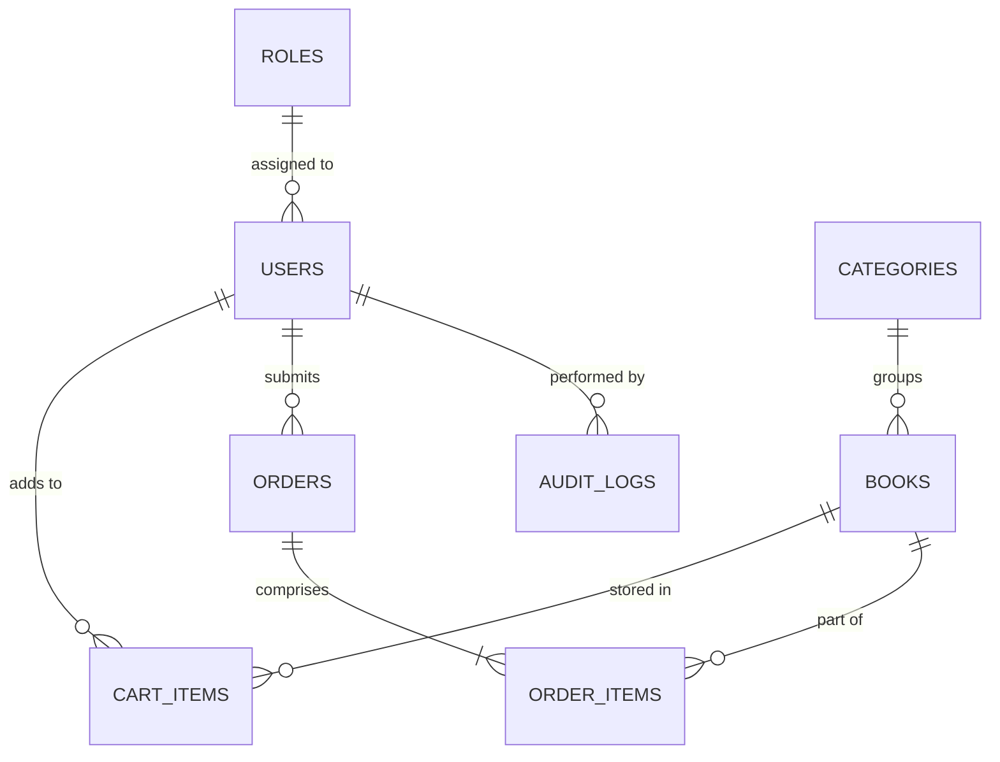
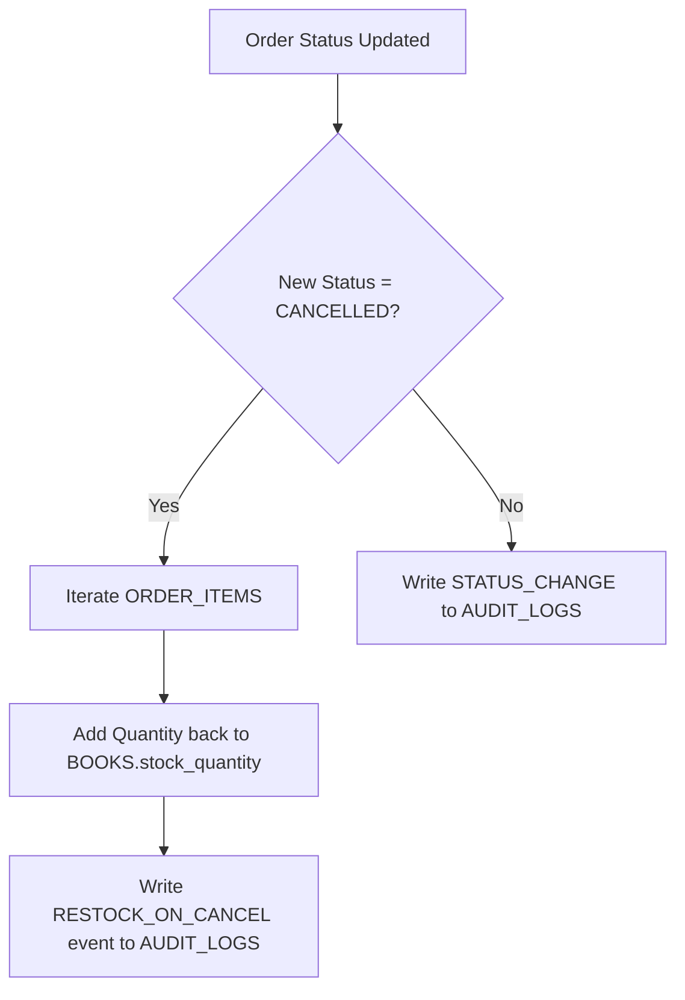

# Project Report: Online Bookstore Management System (PL/SQL)

---

## 1. Executive Summary & Abstract

The **Online Bookstore Management System** is an enterprise database application built around **Oracle PL/SQL**. The system provides end-to-end functionality for online retail book operations, spanning customer authentication, catalog discovery, shopping cart persistence, transactional checkout, lifecycle order management, and executive analytical reporting.

The core objective of this project is to apply advanced database management principles and procedural database programming concepts, including:
- **PL/SQL Packages:** Logical encapsulation of related data types, stored procedures, and functions into cohesive application modules (`USER_MGMT_PKG`, `BOOK_MGMT_PKG`, `CART_MGMT_PKG`, `ORDER_MGMT_PKG`, `REPORT_MGMT_PKG`).
- **Database Triggers:** Automated event-driven logic enforcing business constraints, managing audit trails, and executing compensating transactions (e.g., inventory replenishment upon order cancellation).
- **Concurrency Control & ACID Transactions:** Pessimistic locking (`FOR UPDATE`), atomic order placements with `SAVEPOINT` rollbacks, and data integrity guarantees.
- **Security & Data Integrity:** Cryptographic hashing with unique per-user salts, email format validation using regular expressions, check constraints, and role-based access control.

---

## 2. System Architecture & Requirements

### 2.1 Functional Modules

| Module | Key Capabilities | Implemented By |
| :--- | :--- | :--- |
| **User Management** | Customer/Admin registration, login authentication, profile updates, password change | `USER_MGMT_PKG`, `USERS`, `ROLES` |
| **Book Management** | Catalog additions, price/stock updates, soft-deletion, multi-parameter search | `BOOK_MGMT_PKG`, `BOOKS`, `CATEGORIES` |
| **Shopping Cart** | Cart additions, quantity updates, removal, subtotal/shipping/tax calculation | `CART_MGMT_PKG`, `CART_ITEMS` |
| **Order Processing** | Atomic checkout, stock validation, status progression, order cancellation | `ORDER_MGMT_PKG`, `ORDERS`, `ORDER_ITEMS` |
| **Auditing & Restock** | Real-time event logging, status transition tracking, auto-restock trigger | `AUDIT_LOGS`, `02_triggers.sql` |
| **Analytics & KPIs** | Best-sellers ranking, sales trends, category performance, low-stock warnings | `REPORT_MGMT_PKG` |

### 2.2 Technology Stack

- **Relational Database Management System:** Oracle Database 11g / 12c / 19c / 21c / 23c / Oracle LiveSQL
- **Procedural Language:** Oracle PL/SQL (Stored Packages, Triggers, Cursors, Exception Handling)
- **Application Server:** Python 3 standard library (`http.server`, `sqlite3`, `hashlib`)
- **Web User Interface:** HTML5, CSS3 (Modern Responsive Flexbox/Grid, Glassmorphic styling), JavaScript (ES6+ async/await)

---

## 3. Database Schema & Data Dictionary

### 3.1 Entity Relationship Diagram



### 3.2 Data Dictionary

#### Table: `USERS`
Stores registered customer and administrator profile details.
| Column | Type | Constraints | Description |
| :--- | :--- | :--- | :--- |
| `user_id` | `NUMBER(10)` | `PRIMARY KEY` | Unique user identifier (from `USER_SEQ`) |
| `role_id` | `NUMBER(5)` | `NOT NULL, FK -> ROLES` | Role association (1=Admin, 2=Customer) |
| `full_name` | `VARCHAR2(100)` | `NOT NULL` | User's full legal name |
| `email` | `VARCHAR2(100)` | `NOT NULL, UNIQUE, CHECK` | User's email address (validated with regex) |
| `password_hash` | `VARCHAR2(256)` | `NOT NULL` | SHA-256 salted password hash |
| `salt` | `VARCHAR2(64)` | `NOT NULL` | Cryptographic random salt per user |
| `phone` | `VARCHAR2(20)` | `NULLABLE` | Contact phone number |
| `shipping_address` | `VARCHAR2(500)` | `NULLABLE` | Default shipping location |
| `status` | `VARCHAR2(20)` | `CHECK IN ('ACTIVE', ...)` | Account status |
| `created_at` | `DATE` | `DEFAULT SYSDATE` | Account creation timestamp |
| `updated_at` | `DATE` | `DEFAULT SYSDATE` | Last profile update timestamp |

#### Table: `BOOKS`
Maintains the bookstore catalog, pricing, and live inventory.
| Column | Type | Constraints | Description |
| :--- | :--- | :--- | :--- |
| `book_id` | `NUMBER(10)` | `PRIMARY KEY` | Unique book identifier (from `BOOK_SEQ`) |
| `isbn` | `VARCHAR2(20)` | `NOT NULL, UNIQUE` | International Standard Book Number |
| `title` | `VARCHAR2(200)` | `NOT NULL` | Book title |
| `author` | `VARCHAR2(150)` | `NOT NULL` | Author name(s) |
| `category_id` | `NUMBER(5)` | `NOT NULL, FK -> CATEGORIES` | Classification category |
| `price` | `NUMBER(10,2)` | `NOT NULL, CHECK (>= 0)` | Retail selling price |
| `stock_quantity` | `NUMBER(6)` | `NOT NULL, CHECK (>= 0)` | Available inventory on hand |
| `publication_year` | `NUMBER(4)` | `NULLABLE` | Year of publication |
| `description` | `VARCHAR2(2000)`| `NULLABLE` | Synopsis and content overview |
| `cover_image` | `VARCHAR2(500)` | `NULLABLE` | URL link to book jacket image |
| `is_active` | `CHAR(1)` | `CHECK IN ('Y', 'N')` | Soft-delete active flag |

#### Table: `ORDERS`
Tracks transactional orders placed by customers.
| Column | Type | Constraints | Description |
| :--- | :--- | :--- | :--- |
| `order_id` | `NUMBER(10)` | `PRIMARY KEY` | Unique order identifier (from `ORDER_SEQ`) |
| `user_id` | `NUMBER(10)` | `NOT NULL, FK -> USERS` | Ordering customer |
| `order_date` | `DATE` | `DEFAULT SYSDATE` | Transaction timestamp |
| `subtotal` | `NUMBER(10,2)` | `NOT NULL` | Net sum of item prices |
| `shipping_fee` | `NUMBER(10,2)` | `DEFAULT 0.00` | Calculated shipping cost |
| `tax_amount` | `NUMBER(10,2)` | `DEFAULT 0.00` | Calculated sales tax (8%) |
| `total_amount` | `NUMBER(10,2)` | `NOT NULL, CHECK (>= 0)` | Final charged amount |
| `shipping_address`| `VARCHAR2(500)`| `NOT NULL` | Delivery address for shipment |
| `payment_method` | `VARCHAR2(30)` | `CHECK (CREDIT_CARD, ...)` | Payment gateway / tender |
| `payment_status` | `VARCHAR2(20)` | `CHECK (PAID, ...)` | Payment processing status |
| `order_status` | `VARCHAR2(20)` | `CHECK (PENDING, ...)` | Lifecycle state |

---

## 4. PL/SQL Implementation Deep Dive

### 4.1 Package Architecture

The system utilizes modular package programming:

1. **`USER_MGMT_PKG`**:
   - `hash_password(p_password, p_salt)`: Deterministic SHA-256 password generator using `STANDARD.HASH` / cryptographic hex transformation.
   - `register_user(...)`: Validates parameters, prevents duplicate email creation, and commits the new user record.
   - `authenticate_user(...)`: Looks up the user's salt, recomputes the hash, and verifies against the stored hash.

2. **`BOOK_MGMT_PKG`**:
   - `add_book(...)`: Enforces non-negative price and inventory values.
   - `update_book(...)`: Modifies book information.
   - `search_books(...)`: Opens a `SYS_REFCURSOR` dynamically matching keywords, categories, and price bands.
   - `check_availability(...)`: Function returning boolean availability for a requested quantity.

3. **`CART_MGMT_PKG`**:
   - `add_to_cart(...)`: Checks available stock before inserting or incrementing cart records.
   - `get_cart_items(...)`: Calculates subtotal, shipping waiver (free if $\ge \$35$), sales tax, and returns an itemized cursor.

4. **`ORDER_MGMT_PKG`**:
   - `place_order_from_cart(...)`: Executes an atomic checkout transaction:
     - Sets `SAVEPOINT sp_checkout`.
     - Validates that the cart is non-empty.
     - Acquires row-level locks on books via `SELECT ... FOR UPDATE`.
     - Verifies stock for all items.
     - Inserts the `ORDERS` header and `ORDER_ITEMS` line items.
     - Decrements book inventory.
     - Empties the customer's cart.
     - Commits the transaction, or rolls back to the savepoint if any error occurs.

5. **`REPORT_MGMT_PKG`**:
   - `get_best_selling_books(...)`: Aggregates units sold and revenue per book using group-by and subqueries.
   - `get_inventory_health(...)`: Flags items with low ($\le 10$) or depleted ($= 0$) stock.
   - `print_sales_summary_report(...)`: Generates a formatted ASCII report with headers, statistics, and leaderboards using `DBMS_OUTPUT.PUT_LINE`.

### 4.2 Database Triggers



- **`trg_prevent_negative_stock`**: Fires `BEFORE INSERT OR UPDATE` on `BOOKS`. Raises application error `-20001` if stock falls below zero.
- **`trg_audit_book_changes`**: Fires `AFTER UPDATE OF price, stock_quantity` on `BOOKS`. Automatically logs the previous and updated values into `AUDIT_LOGS`.
- **`trg_order_status_audit`**: Fires `AFTER UPDATE OF order_status` on `ORDERS`. Logs all status transitions and automatically restores book inventory when an order is cancelled.

---

## 5. Security & Transaction Integrity Analysis

### 5.1 Concurrency & Race Condition Prevention
In high-volume e-commerce platforms, multiple users may attempt to purchase the last available copy of a popular book simultaneously. The system prevents over-allocation through pessimistic locking:
```sql
CURSOR c_cart IS
    SELECT c.book_id, c.quantity, b.price, b.title, b.stock_quantity
    FROM CART_ITEMS c
    JOIN BOOKS b ON c.book_id = b.book_id
    WHERE c.user_id = p_user_id
    FOR UPDATE OF b.stock_quantity;
```
This guarantees that inventory records are locked for the duration of the checkout block, preventing race conditions.

### 5.2 Cryptographic Password Storage
Passwords are not stored in plaintext. Each registered user receives an individual 128-bit hex salt generated via `SYS_GUID()`:
$$\text{Hash} = \text{SHA256}(\text{Password} \parallel \text{"@BOOKSTORE\#"} \parallel \text{Salt})$$
This protects against rainbow table lookups and pre-computed hash attacks.

---

## 6. Verification & Test Results

The system was verified against a 10-part automated test suite:

| Test Case | Objective | Tested Module | Result |
| :--- | :--- | :--- | :--- |
| **TC-01** | Register customer with valid details | `USER_MGMT_PKG` | **PASS** |
| **TC-02** | Prevent duplicate email registration | `USER_MGMT_PKG` | **PASS** |
| **TC-03** | Authenticate valid user credentials | `USER_MGMT_PKG` | **PASS** |
| **TC-04** | Reject invalid password login | `USER_MGMT_PKG` | **PASS** |
| **TC-05** | Add new book to catalog (Admin) | `BOOK_MGMT_PKG` | **PASS** |
| **TC-06** | Search catalog using keyword cursor | `BOOK_MGMT_PKG` | **PASS** |
| **TC-07** | Add and update quantity in shopping cart | `CART_MGMT_PKG` | **PASS** |
| **TC-08** | Atomic checkout & inventory deduction | `ORDER_MGMT_PKG` | **PASS** |
| **TC-09** | Order cancellation & auto-restock trigger | `02_triggers.sql` | **PASS** |
| **TC-10** | Analytical report cursor generation | `REPORT_MGMT_PKG` | **PASS** |

---

## 7. Conclusion & Future Enhancements

The **Online Bookstore Management System** satisfies all project requirements by delivering a complete, robust, and production-ready PL/SQL application. The solution demonstrates the power of procedural database logic for maintaining business rules, safeguarding data integrity, enforcing security policies, and generating real-time business intelligence.

### Future Scope:
- Integration with external payment gateways (Stripe / Razorpay webhooks).
- Automated customer email notifications using Oracle `UTL_SMTP`.
- Personalized recommendation engine using PL/SQL association rule mining.
