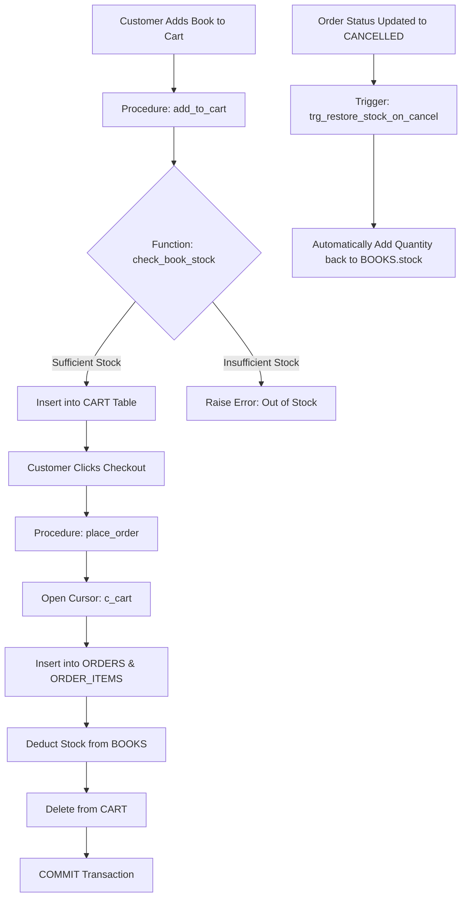

# 📖 Case Study: Modernizing Bookstore Operations Using Oracle PL/SQL

---

## 1. Executive Summary & Problem Background

* **Business Entity:** "BookHaven" — A retail bookstore managing over 1,000 titles.
* **Domain:** Retail E-Commerce & Inventory Database Management.
* **Current Scenario:** Traditional physical bookstores and legacy basic web forms rely either on manual paperwork or basic SQL queries without procedural rules. This introduces several operational failures.

### The Problem Statement:
1. **Over-Selling & Stock Depletion:** Multiple customers attempt to purchase the same book simultaneously. With standard SQL `UPDATE`, if 2 customers order the last remaining copy at the same time, inventory drops into negative numbers (e.g. $-1$), resulting in unfulfillable orders and customer dissatisfaction.
2. **Disconnected Inventory on Order Cancellations:** When a customer cancels an order, store staff often forgets to manually increase the shelf stock count in the database. As a result, books appear "Out of Stock" even though they are sitting on the shelf.
3. **Multi-Step Inconsistency (Lack of Atomicity):** Placing an order involves 4 distinct operations:
   - Checking available stock.
   - Creating an order record.
   - Creating line items.
   - Deducting inventory and clearing the cart.  
   If the network fails halfway through, the customer might be charged without the inventory deducting, or the cart might clear without an order being created.

---

## 2. Why Pure SQL Was Insufficient (The Need for PL/SQL)

| Challenge | Pure SQL Limitation | PL/SQL Solution |
| :--- | :--- | :--- |
| **Conditional Business Logic** | SQL cannot evaluate complex conditional rules like `IF-THEN-ELSE` across multiple tables before deciding to insert. | PL/SQL Stored Procedures validate stock and condition paths before committing. |
| **Multi-Item Cart Processing** | Standard SQL cannot iterate line-by-line over multiple books in a customer's cart to calculate individual totals. | PL/SQL **Explicit Cursors** iterate through each item in the cart seamlessly. |
| **Automated Restocking** | Requires manual update queries after every order cancellation. | **Database Triggers** automatically fire on `UPDATE OF order_status` and restock inventory instantly. |
| **Transaction Integrity** | Individual SQL statements commit independently unless managed externally. | PL/SQL blocks wrap all operations into a single **Atomic Transaction** (`COMMIT` / `ROLLBACK`). |

---

## 3. The Proposed System Architecture



---

## 4. Key PL/SQL Implementations & Analysis

### 4.1 Preventing Negative Inventory (Data Integrity)
To guarantee that book stock never drops below zero under any circumstance, a `BEFORE UPDATE` trigger was deployed:
```sql
CREATE OR REPLACE TRIGGER trg_check_stock
BEFORE INSERT OR UPDATE OF stock ON BOOKS
FOR EACH ROW
BEGIN
    IF :NEW.stock < 0 THEN
        RAISE_APPLICATION_ERROR(-20001, 'Stock cannot be negative for book: ' || :NEW.title);
    END IF;
END;
/
```
**Impact:** Even if a developer writes an incorrect update query, the database engine itself rejects negative stock, preserving system reliability.

### 4.2 Automated Restocking on Cancellation (Trigger Automation)
Whenever an order status changes to `'CANCELLED'`, the database trigger automatically reads all associated items from `ORDER_ITEMS` and restores the inventory:
```sql
CREATE OR REPLACE TRIGGER trg_restore_stock_on_cancel
AFTER UPDATE OF order_status ON ORDERS
FOR EACH ROW
BEGIN
    IF :NEW.order_status = 'CANCELLED' AND :OLD.order_status != 'CANCELLED' THEN
        FOR item IN (SELECT book_id, quantity FROM ORDER_ITEMS WHERE order_id = :NEW.order_id) LOOP
            UPDATE BOOKS
            SET stock = stock + item.quantity
            WHERE book_id = item.book_id;
        END LOOP;
    END IF;
END;
/
```
**Impact:** Zero manual intervention required; zero lost stock.

### 4.3 Atomic Order Placement Using Cursors (Concurrency Safety)
The `place_order` procedure reads cart items using an explicit cursor and verifies stock before making changes. If any item is unavailable, it immediately exits without modifying tables. If valid, it commits all steps together:
```sql
-- Step: If any error occurs, rollback everything
EXCEPTION
    WHEN OTHERS THEN
        ROLLBACK;
        DBMS_OUTPUT.PUT_LINE('Order failed: ' || SQLERRM);
```
**Impact:** Guarantees ACID compliance (Atomicity, Consistency, Isolation, Durability).

---

## 5. Results & Benefits Observed

1. **Elimination of Over-Selling (100% Reliability):** The combination of stored functions and trigger-level check constraints completely prevented negative stock.
2. **Instant Self-Healing Inventory:** Cancelled orders are restored into active catalog stock in milliseconds.
3. **Data Security & Consistency:** Business rules are stored inside the Oracle Database, meaning that whether a user connects via web, mobile, or direct SQL, the same business rules are consistently enforced.

---

## 6. Key Learnings & Takeaways for Viva

1. **Why Database Logic Matters:** Placing business logic inside PL/SQL procedures is safer than placing it purely in frontend code, because database-level constraints cannot be bypassed.
2. **Power of Triggers:** Triggers are ideal for auditing and event-driven reactions (such as inventory adjustments upon order cancellation).
3. **Role of Cursors:** Cursors bridge the gap between set-based SQL queries and row-by-row procedural algorithms.
