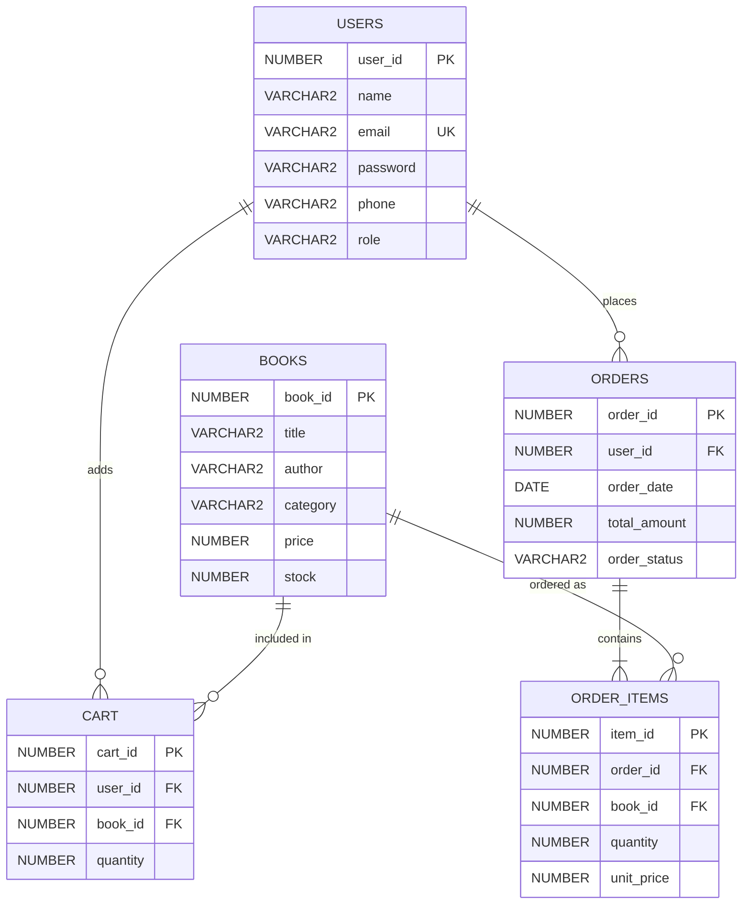

# A MINI-PROJECT REPORT ON
# ONLINE BOOKSTORE MANAGEMENT SYSTEM USING ORACLE PL/SQL

**Submitted in partial fulfillment of the requirements for the award of the Degree of**  
**Bachelor of Technology / Computer Applications / Information Technology**

---

### **Submitted By:**
* **Student Name:** [Your Name]  
* **Roll Number / Enrollment No:** [Your Roll Number]  
* **Branch / Semester:** Computer Science & Engineering / PL/SQL Lab  

### **Under the Guidance of:**
* **Faculty / Guide Name:** [Professor / Guide Name]  
* **Department:** Department of Computer Science & Engineering  
* **Institution:** [Your College / Institute Name]  
* **Academic Year:** 2026  

---

## 📜 CERTIFICATE

This is to certify that the project entitled **"Online Bookstore Management System Using Oracle PL/SQL"** is a bona fide work carried out by **[Your Name]** (Roll No: **[Your Roll Number]**) under my supervision and guidance, in partial fulfillment of the academic curriculum.

The project demonstrates procedural database programming using Oracle PL/SQL, stored procedures, functions, database triggers, and cursor-based data processing.

  

___________________________ &nbsp;&nbsp;&nbsp;&nbsp;&nbsp;&nbsp;&nbsp;&nbsp;&nbsp;&nbsp;&nbsp;&nbsp;&nbsp;&nbsp;&nbsp;&nbsp;&nbsp;&nbsp;&nbsp;&nbsp;&nbsp;&nbsp;&nbsp;&nbsp;&nbsp;&nbsp;&nbsp;&nbsp;&nbsp;&nbsp;&nbsp;&nbsp; ___________________________  
**Project Guide / Supervisor** &nbsp;&nbsp;&nbsp;&nbsp;&nbsp;&nbsp;&nbsp;&nbsp;&nbsp;&nbsp;&nbsp;&nbsp;&nbsp;&nbsp;&nbsp;&nbsp;&nbsp;&nbsp;&nbsp;&nbsp;&nbsp;&nbsp;&nbsp;&nbsp;&nbsp;&nbsp;&nbsp;&nbsp;&nbsp;&nbsp;&nbsp;&nbsp;&nbsp;&nbsp;&nbsp;&nbsp;&nbsp;&nbsp; **Head of Department (HOD)**  
Department of CSE &nbsp;&nbsp;&nbsp;&nbsp;&nbsp;&nbsp;&nbsp;&nbsp;&nbsp;&nbsp;&nbsp;&nbsp;&nbsp;&nbsp;&nbsp;&nbsp;&nbsp;&nbsp;&nbsp;&nbsp;&nbsp;&nbsp;&nbsp;&nbsp;&nbsp;&nbsp;&nbsp;&nbsp;&nbsp;&nbsp;&nbsp;&nbsp;&nbsp;&nbsp;&nbsp;&nbsp;&nbsp;&nbsp;&nbsp;&nbsp;&nbsp;&nbsp;&nbsp;&nbsp;&nbsp;&nbsp;&nbsp;&nbsp;&nbsp;&nbsp; Department of CSE  

---

## 🙏 ACKNOWLEDGEMENT

I express my deepest gratitude to my project guide, **[Professor Name]**, for invaluable guidance, encouragement, and technical suggestions throughout the development of this project.

I am also thankful to our **Head of Department**, faculty members, and lab instructors for providing the necessary computational facilities and environment to complete this project. Finally, I thank my family and peers for their continuous support.

**[Your Name]**  
Roll No: [Your Roll Number]  

---

## 📑 TABLE OF CONTENTS

1. **Chapter 1: Introduction**
   - 1.1 Project Overview
   - 1.2 Problem Statement
   - 1.3 Project Objectives
2. **Chapter 2: System Analysis and Design**
   - 2.1 Software & Hardware Requirements
   - 2.2 Entity-Relationship (ER) Diagram
   - 2.3 Relational Schema Design
3. **Chapter 3: PL/SQL Implementation**
   - 3.1 Database Sequences
   - 3.2 Stored Functions
   - 3.3 Stored Procedures
   - 3.4 Database Triggers
   - 3.5 Cursors & Transaction Control
4. **Chapter 4: Testing & Output Results**
   - 4.1 Test Cases Matrix
   - 4.2 Script Execution Output
5. **Chapter 5: Conclusion & Future Scope**
6. **References**

---

## CHAPTER 1: INTRODUCTION

### 1.1 Project Overview
The **Online Bookstore Management System** is a procedural database project developed using **Oracle PL/SQL**. The system manages the primary operations of an online bookstore: maintaining catalog titles, managing book inventory, processing user registrations, managing customer shopping carts, and executing atomic order placements.

### 1.2 Problem Statement
Traditional retail bookstores encounter severe inventory tracking challenges:
* Overselling books when multiple customers order simultaneously.
* Manual bookkeeping leading to human error in calculating cart totals.
* Missing stock restock when orders are cancelled.
Standard SQL alone lacks procedural control structures (such as conditional checks and cursor-driven loops) to maintain multi-step business logic safely.

### 1.3 Project Objectives
* Design a normalized relational schema with primary and foreign key constraints.
* Implement **Stored Procedures** for user registration, shopping cart additions, and order checkouts.
* Develop **Stored Functions** to evaluate real-time stock availability and calculate monetary cart totals.
* Implement **Database Triggers** to enforce non-negative inventory and automatically restore stock upon order cancellation.
* Utilize **Explicit Cursors** to iterate through multi-item shopping carts.

---

## CHAPTER 2: SYSTEM ANALYSIS AND DESIGN

### 2.1 Requirements
* **Operating System:** Windows 10 / 11
* **Database Engine:** Oracle Database 11g / 12c / 19c / 21c / 23c (or Oracle LiveSQL)
* **Development Interface:** SQL*Plus / Oracle SQL Developer
* **Programming Languages:** SQL and Oracle PL/SQL

### 2.2 Entity-Relationship (ER) Diagram

---

## CHAPTER 3: PL/SQL IMPLEMENTATION

### 3.1 Tables Description
1. **`USERS`**: Stores user authentication credentials, contact phone numbers, and user roles (`CUSTOMER` or `ADMIN`).
2. **`BOOKS`**: Maintains the catalog of titles, authors, categories, unit prices, and remaining inventory stock.
3. **`CART`**: Manages active items placed into user shopping carts before final checkout.
4. **`ORDERS`**: Captures placed order summaries, timestamps, order status (`PLACED` or `CANCELLED`), and total amounts.
5. **`ORDER_ITEMS`**: Captures line items associated with each order to maintain purchasing history.

### 3.2 Functions
* **`check_book_stock(p_book_id, p_qty)`**: Takes a book identifier and desired quantity; returns `BOOLEAN` (`TRUE` if available, `FALSE` otherwise).
* **`get_cart_total(p_user_id)`**: Calculates the sum of `(quantity * price)` across all books in a customer's cart.

### 3.3 Procedures
* **`register_user(...)`**: Inserts a new user record with duplicate email check.
* **`add_to_cart(...)`**: Validates available stock using the stored function before inserting or incrementing the cart quantity.
* **`place_order(p_user_id)`**: Uses an **explicit cursor** to iterate over cart books, validates stock, writes records into `ORDERS` and `ORDER_ITEMS`, decreases stock in `BOOKS`, and clears the shopping cart atomically.
* **`display_all_books`**: Opens a cursor to fetch and display the bookstore catalog in a formatted table via `DBMS_OUTPUT`.

### 3.4 Triggers
* **`trg_check_stock`**: `BEFORE INSERT OR UPDATE OF stock ON BOOKS`. Raises error `-20001` if stock is negative.
* **`trg_restore_stock_on_cancel`**: `AFTER UPDATE OF order_status ON ORDERS`. Automatically reads `ORDER_ITEMS` and adds book quantities back to `BOOKS` stock whenever an order is marked `CANCELLED`.

---

## CHAPTER 4: TESTING & OUTPUT RESULTS

### 4.1 Test Cases Matrix

| Test ID | Test Scenario | Input Data | Expected Output | Actual Output | Status |
| :--- | :--- | :--- | :--- | :--- | :--- |
| **TC-01** | User Registration | Name: "Rahul", Email: "rahul@gmail.com" | User registered successfully | Output: "User Rahul registered successfully!" | **PASS** |
| **TC-02** | Duplicate Email Check | Same email "rahul@gmail.com" | `DUP_VAL_ON_INDEX` handled | Output: "Email already registered!" | **PASS** |
| **TC-03** | Add In-Stock Book to Cart | Book ID: 101, Qty: 2 | Item added to Cart table | Output: "Book added to cart successfully." | **PASS** |
| **TC-04** | Add Out-of-Stock Book | Book ID: 101, Qty: 999 | Stock check returns FALSE | Output: "Requested quantity not available in stock." | **PASS** |
| **TC-05** | Order Placement & Stock Deduction | User ID: 1 (with 2 items in cart) | Order created, stock deducted, cart cleared | Order #5001 placed, stock decremented by 2 | **PASS** |
| **TC-06** | Order Cancellation Trigger | Update status of #5001 to 'CANCELLED' | Stock replenished automatically | Trigger fires; book stock restored | **PASS** |

---

## CHAPTER 5: CONCLUSION & FUTURE SCOPE

The **Online Bookstore Management System** demonstrates how relational database systems are elevated from passive data stores into active, self-enforcing applications using Oracle PL/SQL. Stored procedures, functions, cursors, and triggers ensure robust data consistency, transactional safety, and automated business workflows.

### Future Scope:
* Developing a GUI frontend connected via REST APIs.
* Integrating payment gateway verification procedures.
* Implementing customer book rating and review tables.

---

## REFERENCES
1. Steven Feuerstein, *Oracle PL/SQL Programming*, 6th Edition, O'Reilly Media.
2. Abraham Silberschatz, Henry F. Korth, *Database System Concepts*, McGraw-Hill.
3. Oracle Database Documentation: *PL/SQL Language Reference Guide (19c/21c)*.
